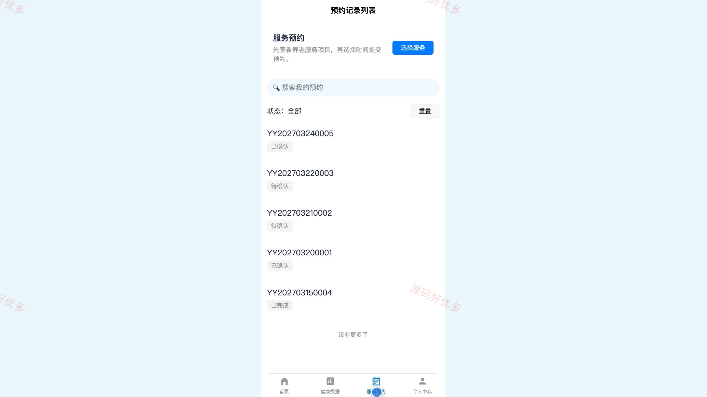
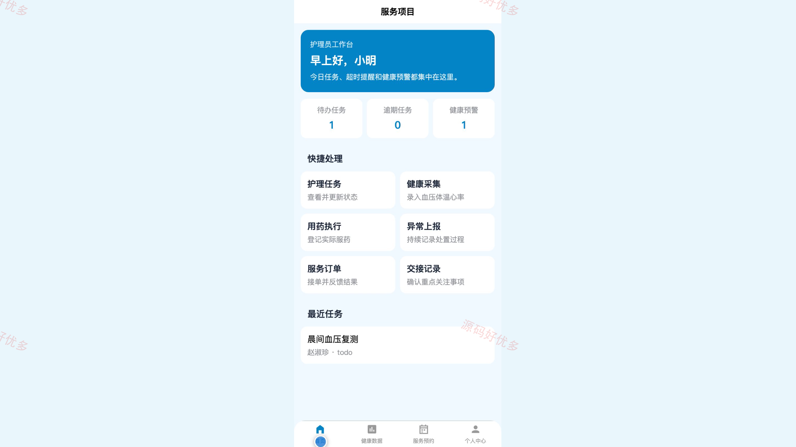
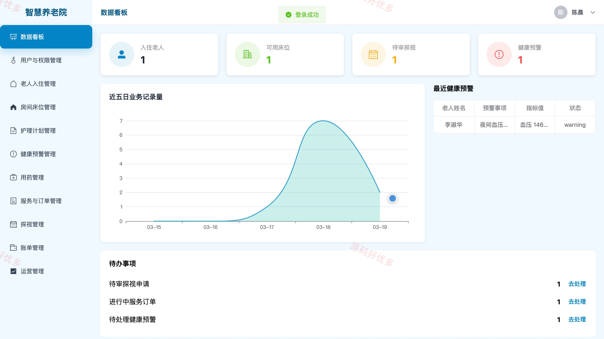
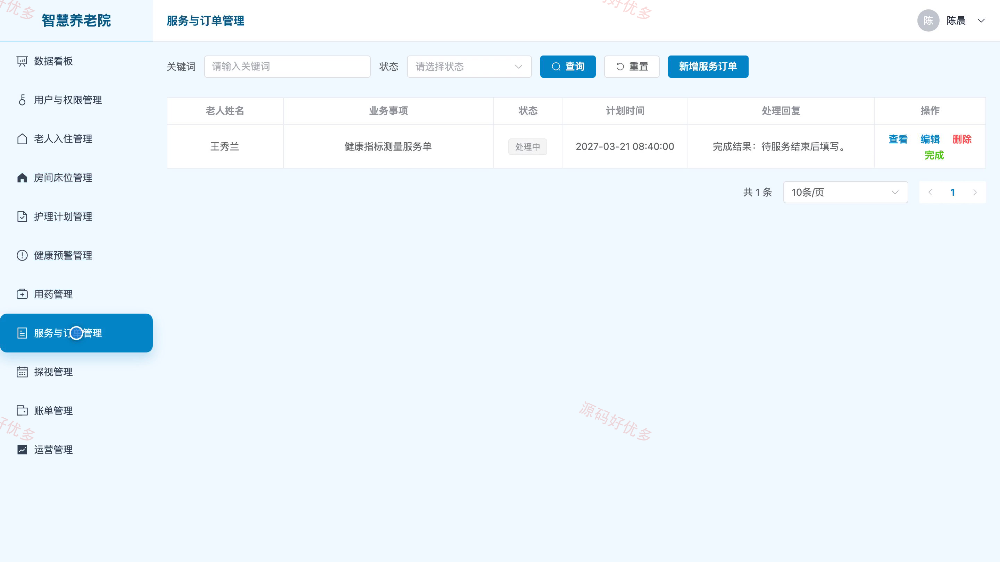
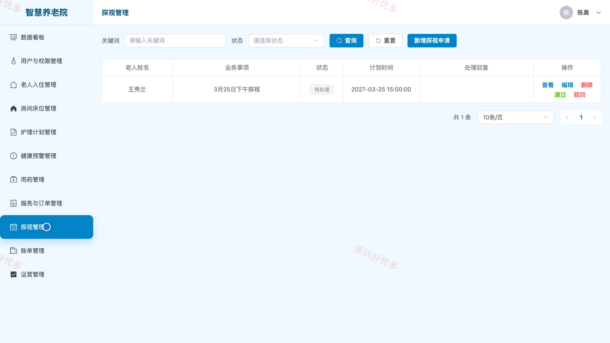

# bs012B
bs012B智慧养老院小程序源码 Java SpringBoot3 Vue3 设计文档 PPT
## 源码问题查看主页咨询

### 一、关键词
智慧养老、机构养老、老人照护、健康监测、养老服务预约

### 二、作品包含
源码+数据库+万字设计文档+PPT+全套环境和工具资源+本地部署教程

### 三、项目技术
前端技术： Html、Css、Js、Vue3.4、Element-Plus、uniapp
后端技术：Java、SpringBoot3.2.0、MyBatis-Plus

### 四、运行环境要求
开发工具：IDEA/eclipse + VSCODE + HBuilder X + 微信开发者工具

数据库：MySQL5.7+（共7张表）

数据库管理工具：Navicat10以上版本

环境配置软件： JDK17 + Maven3.6

前端Nodejs：16+

浏览器：谷歌浏览器

### 五、项目介绍
项目编号：bs012B

智慧养老院小程序面向家属、护理员和管理员，围绕老人入住照护、健康数据记录、护理任务执行、服务与探视预约、费用账单及异常预警形成养老服务闭环。家属可在小程序查看老人档案与护理动态并预约服务，护理员负责护理、用药和异常处置，管理员通过后台统筹床位、计划、订单、账单和运营信息。

角色：家属、护理员、管理员

家属功能：账号登录与个人资料维护、亲属绑定与审核进度查询、老人档案与入住资料查看、健康数据与护理动态查看、养老服务与探视预约、费用账单与缴费状态查询、养老院通知公告浏览、服务意见反馈与回复查看。

护理员功能：账号登录与护理工作台、护理任务查看与状态更新、护理执行内容记录、老人健康指标采集、用药安排与执行登记、老人异常上报与处置跟踪、服务订单接收与完成反馈、班次交接事项记录。

管理员功能：家属护理员账号与权限管理、老人入住与亲属绑定审核、房间床位与入住状态管理、护理计划分派与健康预警跟踪、老人用药计划管理、服务项目与预约订单管理、探视申请与费用账单管理、公告反馈与运营统计管理。

### 六、运行截图

